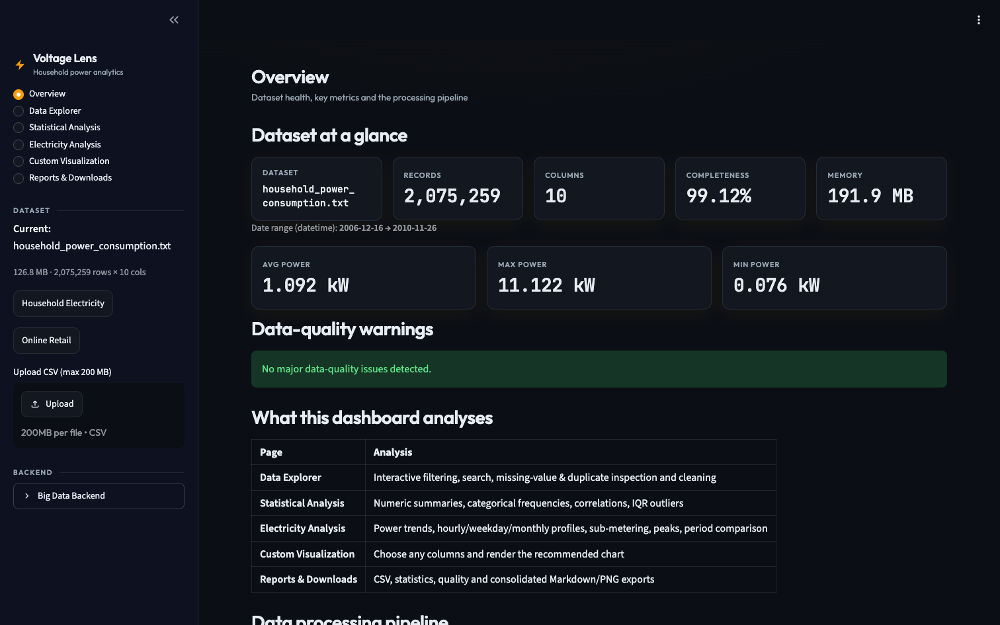
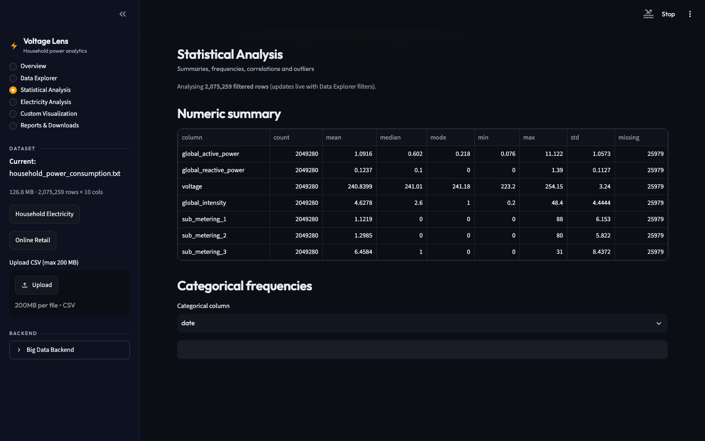
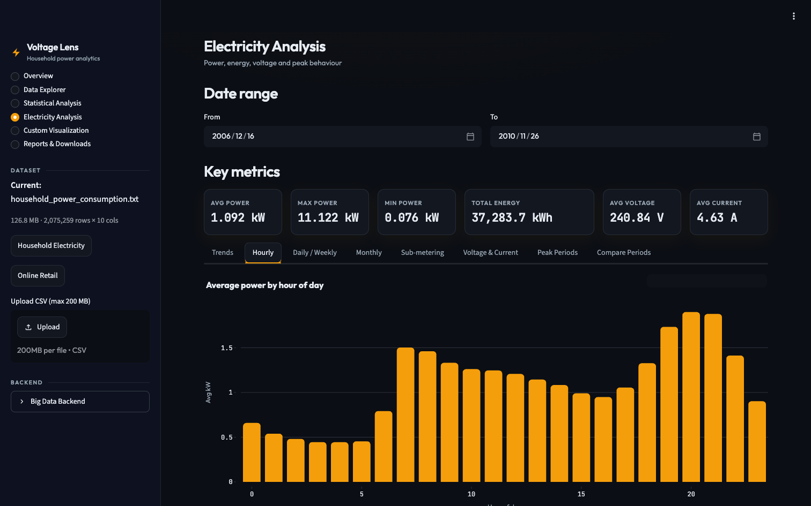
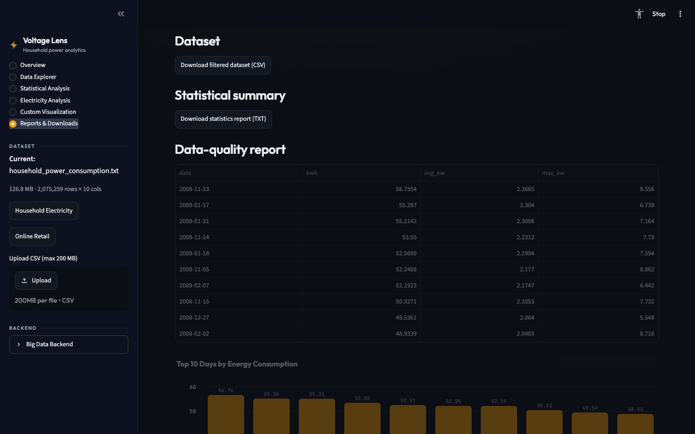

# ⚡ Household Electricity Analytics (Voltage Lens)

An interactive **Big Data course project**: a six-page **Streamlit dashboard** that
turns the UCI *Individual Household Electric Power Consumption* dataset —
**2,075,259 minute-level readings** from one household (Dec 2006 – Nov 2010) —
into statistics, consumption profiles and charts. A scripted
**Hadoop/HDFS + Hive + PySpark (+ Pig)** batch pipeline is included to
demonstrate the distributed-computing side of the course.

A second dataset (UCI *Online Retail*, 541,909 rows) is bundled to show the same
load → validate → clean → analyze → visualize → export pipeline works on any tabular data.



## Table of contents
- [Features](#-features)
- [Architecture](#-architecture)
- [Quickstart](#-quickstart)
- [Datasets](#-datasets)
- [Big Data components](#-big-data-components)
- [Testing](#-testing)
- [Project structure](#-project-structure)
- [Screenshots](#-screenshots)
- [Deployment](#-deployment)
- [Author & acknowledgements](#-author--acknowledgements)
- [License & attribution](#-license--attribution)

## ✨ Features

- **6-page dashboard** (`app.py`): Project Overview · Data Explorer · Statistical
  Analysis · Electricity Consumption Analysis · Custom Visualization · Reports & Downloads
- **Flexible ingestion** — bundled UCI samples, validated CSV upload (≤ 200 MB,
  chunked reader), or Parquet files produced by the Spark pipeline
- **Validation & cleaning** — column normalization, datetime parsing, five
  missing-value strategies (`keep / drop_rows / fill_mean / fill_median / fill_mode`),
  duplicate handling, data-quality warnings
- **Electricity analytics** — power statistics, energy in kWh, hourly / weekday /
  monthly profiles, sub-metering shares, voltage & current stats, top-N peak days,
  two-period comparison
- **General analytics** — numeric summaries, categorical frequencies, correlation
  matrix, IQR outlier detection
- **Plotly visualization** — 11 chart builders with automatic downsampling
  (≤ 10k points) for responsive rendering
- **Exports** — filtered CSV, statistics / quality TXT reports, consolidated
  Markdown report, chart PNG
- **Big Data backend** — HDFS, Hive SQL, PySpark jobs and an optional Pig script,
  orchestrated with Docker Compose

### Headline results (full dataset)
| Metric | Value |
|---|---|
| Mean active power | 1.092 kW (max 11.122 kW) |
| Total energy | ≈ 37,283.7 kWh |
| Daily peak | 20:00 (1.899 kW average) |
| Seasonality | Winter-dominated (top months: Dec 2007, Jan 2007, Jan 2008) |

## 🏗 Architecture

```
data sources → ingestion → validation & cleaning → pandas analytics
      → Plotly visualization → Streamlit dashboard (6 pages)

side pipeline (batch):  raw .txt → HDFS → Hive / PySpark → Parquet → dashboard
```

Full layered diagram: [`reports/architecture_diagram.svg`](reports/architecture_diagram.svg).

## 🚀 Quickstart

Requires **Python 3.13** (3.9+ should work).

```bash
# 1. clone
git clone https://github.com/nithishkumarjoshi5-lgtm/friendly-octo-adventure.git
cd friendly-octo-adventure

# 2. create a virtual environment
python3 -m venv .venv
source .venv/bin/activate            # Windows: .venv\Scripts\activate

# 3. install dependencies
pip install -r requirements.txt

# 4. (recommended) download the main dataset — see "Datasets" below

# 5. run the dashboard
streamlit run app.py
```

The app opens at <http://localhost:8501>. Use the sidebar to load a sample dataset
or upload your own CSV.

## 📦 Datasets

| Dataset | In repo? | Size |
|---|---|---|
| UCI *Online Retail* (`data/raw/Online Retail.xlsx`) | ✅ Yes | ≈ 23 MB |
| UCI *Household Electric Power Consumption* | ❌ No — too large for GitHub (>100 MB) | ≈ 133 MB |

**Download the household power dataset** (run from the project root):

```bash
mkdir -p data/raw
curl -L -o data/raw/household_power_consumption.zip \
  "https://archive.ics.uci.edu/static/public/235/individual+household+electric+power+consumption.zip"
unzip -o data/raw/household_power_consumption.zip -d data/raw/
# → data/raw/household_power_consumption.txt
```

Windows without `curl`/`unzip`: download from
<https://archive.ics.uci.edu/dataset/235> and extract the `.txt` file into `data/raw/`.

The Online Retail workbook can be re-downloaded from
<https://archive.ics.uci.edu/dataset/352> if needed.

## 🖥 Big Data components

The interactive dashboard is pure Python (pandas / Plotly / Streamlit). The batch
backend is fully scripted but was **not executed during development** (no JVM/Docker
on the build machine):

| Component | Files | Status |
|---|---|---|
| Streamlit dashboard + analytics | `app.py`, `src/` | ✅ Tested — 185 pytest tests pass |
| HDFS (Hadoop 3.4.1) | `docker-compose.bigdata.yml` | 🟡 Provided, not executed |
| Hive 4 + PostgreSQL metastore | `hive/*.hql` | 🟡 Provided, not executed |
| PySpark 4 jobs | `spark/*.py` | 🟡 Provided — needs Java 17/21 |
| Apache Pig (optional) | `pig/electricity_analysis.pig` | 🟡 Provided, not executed |

Run instructions: [`docs/BIGDATA_SETUP.md`](docs/BIGDATA_SETUP.md).
The credentials in `docker-compose.bigdata.yml` are throwaway local-dev defaults —
change them before using anywhere other than your own machine.

## 🧪 Testing

```bash
pytest tests/ -q
```

Covers data loading, validation, cleaning, analytics, visualization builders,
report exporters and an end-to-end integration test. Details:
[`reports/TESTING_RESULTS.md`](reports/TESTING_RESULTS.md).

## 📁 Project structure

```
├── app.py                        # Streamlit dashboard (6 pages)
├── requirements.txt              # dashboard dependencies
├── requirements-spark.txt        # pyspark (local-mode pipeline)
├── src/
│   ├── data_loader.py            # samples, CSV upload, chunked reader
│   ├── data_validation.py        # upload checks, DataFrame profiling
│   ├── data_cleaning.py          # missing/duplicate strategies
│   ├── general_analytics.py      # summaries, correlations, outliers
│   ├── electricity_analytics.py  # kWh, profiles, peaks, sub-metering
│   ├── visualization.py          # Plotly chart builders
│   ├── export_reports.py         # CSV / TXT / Markdown exporters
│   └── theme.py                  # shared design tokens
├── tests/                        # pytest suite
├── hive/                         # HiveQL tables + analytics queries
├── spark/                        # PySpark cleaning + analysis jobs
├── pig/                          # optional Pig Latin script
├── docker-compose.bigdata.yml    # Hadoop + Hive + PostgreSQL + Spark stack
├── docs/                         # Big Data setup + deployment guides
├── data/raw/                     # datasets (large one downloaded separately)
└── reports/                      # project report, slides, diagram, screenshots
```

## 🖼 Screenshots

| Overview | Statistical analysis |
|---|---|
|  |  |

| Hourly consumption | Reports & downloads |
|---|---|
|  |  |

## 🌐 Deployment

See [`docs/DEPLOYMENT.md`](docs/DEPLOYMENT.md) — Streamlit Community Cloud, your own
server, or a Cloudflare Tunnel.

## 👤 Author & acknowledgements

- **Author:** V. Nithish Kumar Joshi — [@nithishkumarjoshi5-lgtm](https://github.com/nithishkumarjoshi5-lgtm)
- Built for a *Fundamentals of Big Data* course.
- Acknowledgements: **Rakesh Vallangi** — contributed to the development of this project, including the Big Data pipeline scripts and deployment setup.

## 📄 License & attribution

Both datasets are from the [UCI Machine Learning Repository](https://archive.ics.uci.edu)
under **CC BY 4.0** — full citations in [`reports/ATTRIBUTION.md`](reports/ATTRIBUTION.md).

Add a `LICENSE` file for the code (MIT is a common choice; GitHub can add it for you
when you create the repo: *Add file → Create new file → name it `LICENSE`*).
